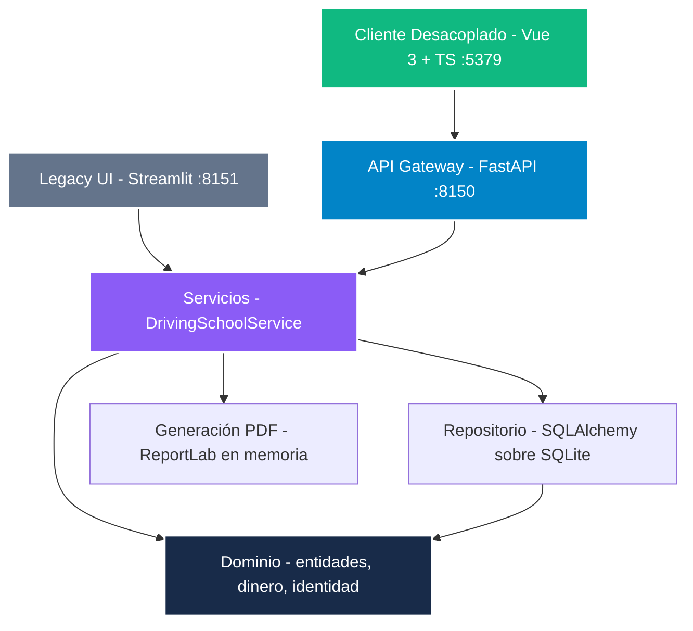

<picture>
  <source media="(prefers-color-scheme: dark)" srcset="docs/assets/banner-dark.svg">
  <source media="(prefers-color-scheme: light)" srcset="docs/assets/banner-light.svg">
  
</picture>

# NainDrive — Motor Determinista de Gestión de Autoescuela y Facturación

[](README.md)
[](README.es.md)
[](https://github.com/Nain9Dev/Gestion-Autoescuela-Python/actions/workflows/ci.yml)
[](https://drive.naindev.com/)
[](https://status.naindev.com)
[](https://github.com/Nain9Dev/engineering-handbook)
[](https://github.com/Nain9Dev/engineering-handbook/blob/main/governance/zero-cost-philosophy.md)
[](https://www.python.org/)
[](https://fastapi.tiangolo.com/)
[](https://vuejs.org/)
[](https://www.typescriptlang.org/)

Python 3.12 · FastAPI :8150 · Vue 3 + TypeScript :5379 · Clean Architecture · Pydantic v2 · SQLAlchemy 2.0

Plataforma operativa de autoescuela donde la aritmética financiera es verificable: los importes son `Decimal`, el redondeo es explícito, los documentos de identidad están validados por suma de comprobación y el total de la factura coincide exactamente con la suma de sus componentes con cero tolerancia.

---

## Qué demuestra este proyecto

- **El dinero nunca es flotante.** Cada importe es un `Decimal`, cuantificado a dos decimales con redondeo simétrico hacia arriba (*half-up*) a través de un único módulo de dominio (`src/domain/money.py`). El redondeo por defecto de Python (`round`) redondea hacia el dígito par; la facturación oficial española redondea alejándose de cero. Con una base imponible de 350.50, el IVA es exactamente 73.605, donde ambos métodos discrepan por un céntimo. El motor produce exactamente 73.61.
- **Los totales cuadran de forma estricta.** El modelo de factura se invalida si las líneas no suman exactamente la base y el IVA declarados. No existe margen de tolerancia, pues la tolerancia en un invariante financiero equivale a desconfiar de la aritmética.
- **La identidad se calcula, no se busca por patrón.** Los documentos españoles `DNI` y `NIE` incorporan una letra de control calculada con el número módulo 23. El validador computa dicha letra de forma que `12345678A` es rechazado y `12345678Z` es aceptado.
- **Generación de PDF en memoria sin disco.** Los ficheros PDF de factura oficial se compilan en memoria mediante ReportLab y se transmiten directamente vía HTTP (`/api/v1/students/{dni}/pdf`), sin escribir archivos temporales en disco (REQ-009).
- **Trazabilidad 100% de Requisitos a Tests.** Cada requisito funcional está mapeado a pruebas automatizadas en [`docs/50-traceability.md`](docs/50-traceability.md). Los 14 requisitos están cubiertos por 55 pruebas.
- **Clean Architecture con Cliente Desacoplado.** La deuda técnica de frontera arquitectónica (ADR-0003) se eliminó mediante una capa de servicio de aplicación (`DrivingSchoolService`). `src/ui/` no tiene importaciones de repositorio. Tanto la SPA moderna en Vue 3 como la interfaz Streamlit consumen el mismo servicio de aplicación.

---

## Arquitectura

Las dependencias apuntan estrictamente hacia el interior. El dominio no tiene dependencias externas.



| Capa | Responsabilidad |
| :--- | :--- |
| `NainDrive.Client/` | Cliente desacoplado Vue 3 + TypeScript (:5379): barra de navegación, panel SVG, fichas de alumno con cajón de facturas, línea temporal de exámenes y vehículos |
| `src/api/` | API REST FastAPI (:8150) con documentación interactiva OpenAPI Scalar en `/docs` |
| `src/services/` | Orquestación de aplicación en `DrivingSchoolService` y generación de PDF en memoria |
| `src/domain/` | Entidades e invariantes. `money.py` (política de redondeo), `identity.py` (módulo 23) |
| `src/repository/` | Persistencia SQLAlchemy sobre SQLite con datos sintéticos iniciales |
| `src/ui/` | Interfaz secundaria Streamlit (:8151), renderizador desacoplado (< 200 líneas por componente) |
| `tests/` | Pruebas automáticas de integración y unitarias |

---

## Asignación de Puertos

Registrados en `D:\Development\Tools\dev-ports.json`:

| Servicio | Puerto | Descripción |
| :--- | :--- | :--- |
| **NainDrive.Client** | `5379` | Frontend SPA en Vue 3 + TypeScript |
| **FastAPI REST API** | `8150` | Gateway de API REST y documentación Scalar en `/docs` |
| **Streamlit UI** | `8151` | Panel complementario legado |

---

## Puesta en marcha rápida

### 1. Backend y Pruebas

```powershell
python -m venv .venv
.\.venv\Scripts\activate
pip install -r requirements.txt

# Ejecutar las 55 pruebas automatizadas
pytest -v

# Arrancar la API Gateway FastAPI (puerto 8150)
uvicorn src.api.main:app --port 8150 --reload
```

La documentación interactiva OpenAPI Scalar está disponible en `http://localhost:8150/docs`.

### 2. Cliente Frontend (NainDrive.Client)

```powershell
cd NainDrive.Client
npm install
npm run build
npm run dev
```

El cliente arranca en `http://localhost:5379` y redirige las llamadas `/api/v1` a la API FastAPI.

### 3. Interfaz Alternativa Streamlit

```powershell
streamlit run src/ui/app.py --server.port 8151
```

---

## Lo que este proyecto no es

Una pieza de portfolio que demuestra rigor de arquitectura y cálculo aritmético, no un ERP comercial de empresa.

- El PDF generado es un modelo demostrativo. No incluye series secuenciales de factura, datos fiscales de emisor ni política de retención legal.
- El tipo de IVA del 21% se aplica uniformemente. Ciertos conceptos formativos de autoescuela pueden acogerse a exenciones o tipos diferenciados según plan de estudios (registrado en Q-001).
- No incorpora autenticación externa ni aislamiento multiinquilino, excluidos deliberadamente para preservar el despliegue local a coste cero.

---

## Autor

Arquitectura e implementación por [naindev](https://www.naindev.com/).
