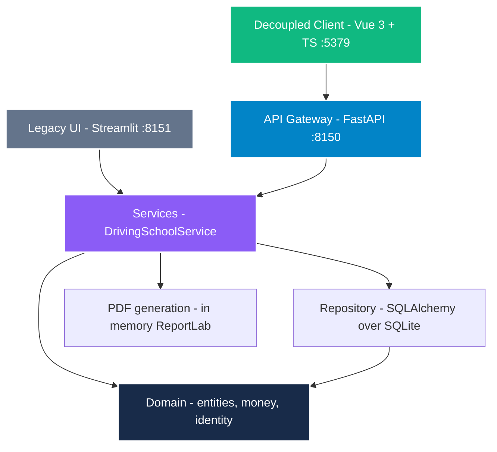

# NainDrive — Deterministic Driving School Management & Billing Engine

[](https://drive.naindev.com/)
[](https://www.python.org/)
[](https://fastapi.tiangolo.com/)
[](https://vuejs.org/)
[](https://www.typescriptlang.org/)

Python 3.12 · FastAPI :8150 · Vue 3 + TypeScript :5379 · Clean Architecture · Pydantic v2 · SQLAlchemy 2.0

A driving school operational platform where the financial arithmetic is verifiable: amounts are `Decimal`, rounding is explicit, identity documents are checksum-verified, and the stated invoice total equals the sum of its parts with zero tolerance.

---

## What this demonstrates

- **Money is never a float.** Every amount is a `Decimal`, quantised to two places with half-up rounding through a single domain module (`src/domain/money.py`). Python's built-in `round` breaks ties toward the even digit; invoicing breaks them away from zero. On a taxable base of 350.50 the tax is exactly 73.605, where the two conventions disagree by a cent. The engine returns 73.61.
- **Totals reconcile exactly.** The invoice model rejects itself if the line items do not sum to the stated subtotal and VAT. There is no tolerance, because a tolerance on a financial invariant is a declaration that the arithmetic is untrusted.
- **Identity is verified, not pattern-matched.** Spanish `DNI` and `NIE` carry a control letter derived from the number modulo 23. The validator computes it, so `12345678A` is rejected while `12345678Z` is accepted. A regex shape check would accept both.
- **Zero-disk in-memory PDF generation.** Official invoice PDFs are compiled in memory using ReportLab and streamed directly over HTTP byte streams (`/api/v1/students/{dni}/pdf`), writing zero temporary files to disk (REQ-009).
- **100% Requirements-to-Tests Traceability.** Every single requirement maps to an automated test in [`docs/50-traceability.md`](docs/50-traceability.md). All 14 requirements are covered across 55 passing tests.
- **Clean Architecture with Decoupled Client.** The architectural boundary debt in ADR-0003 was eliminated by introducing an application service layer (`DrivingSchoolService`). `src/ui/` has 0 repository imports. Both the modern Vue 3 SPA and the legacy Streamlit UI consume the exact same application service.

---

## Architecture

Dependencies point strictly inward. The domain depends on nothing.



| Layer | Responsibility |
| :--- | :--- |
| `NainDrive.Client/` | Decoupled Vue 3 + TypeScript client (:5379), dark luxury glassmorphism UI |
| `src/api/` | FastAPI REST gateway (:8150) with Scalar interactive OpenAPI docs at `/docs` |
| `src/services/` | `DrivingSchoolService` application orchestration and in-memory PDF generation |
| `src/domain/` | Entities and invariants. `money.py` (rounding policy), `identity.py` (modulo 23) |
| `src/repository/` | SQLAlchemy persistence over SQLite with synthetic seed fixtures |
| `src/ui/` | Secondary Streamlit UI (:8151), strictly dumb renderer (< 200 lines components) |
| `tests/` | 55 automated integration and unit tests |

---

## Port Allocation

Registered in `D:\Development\Tools\dev-ports.json`:

| Service | Port | Description |
| :--- | :--- | :--- |
| **NainDrive.Client** | `5379` | Vue 3 + TypeScript SPA frontend |
| **FastAPI REST API** | `8150` | REST API gateway & Scalar `/docs` |
| **Streamlit UI** | `8151` | Legacy single-page dashboard |

---

## Quickstart

### 1. Backend & Tests

```powershell
python -m venv .venv
.\.venv\Scripts\activate
pip install -r requirements.txt

# Run all 55 automated tests
pytest -v

# Start FastAPI API Gateway (port 8150)
uvicorn src.api.main:app --port 8150 --reload
```

Interactive Scalar OpenAPI documentation is available at `http://localhost:8150/docs`.

### 2. Frontend Client (NainDrive.Client)

```powershell
cd NainDrive.Client
npm install
npm run build
npm run dev
```

The client starts on `http://localhost:5379` and proxies `/api/v1` calls to the FastAPI gateway.

### 3. Alternative Streamlit Runtime

```powershell
streamlit run src/ui/app.py --server.port 8151
```

---

## What this is not

A portfolio piece demonstrating architecture and arithmetic rigor, not an enterprise ERP.

- The generated PDF is a commercial mock-up. It has no sequential invoice series, no issuer tax details and no retention policy, so it is not a legally valid invoice.
- The 21 percent `IVA` rate is applied uniformly. Driving school tuition may qualify for exemptions or differentiated rates depending on the syllabus; this is unconfirmed and recorded in Q-001.
- There is no external authentication or multi-tenant isolation. Each is a deliberate exclusion recorded in the charter to maintain zero-cost local execution.

---

## Author

Architecture and implementation by [naindev](https://www.naindev.com/).
