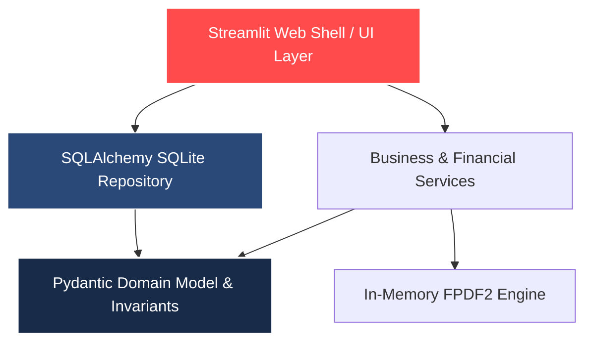

# Sistema Inteligente de Gestión y Facturación de Autoescuelas

[](https://www.python.org/)
[](#)
[](https://streamlit.io)
[](https://www.sqlalchemy.org/)
[](https://docs.pydantic.dev/)

Plataforma Web interactiva y motor contable diseñado para la gestión integral, monitorización de flotas y facturación automatizada de autoescuelas. Construido con **Python 3.12**, principios estrictos de **Clean Architecture**, modelado de datos con **Pydantic v2** y persistencia transaccional en **SQLite**.

---

## Características y Valor para el Negocio

1. **Dashboard Ejecutivo 360°:** Visualización en tiempo real de ingresos brutos proyectados, recaudación tributaria de IVA (21%), saldos pendientes por cobrar y gráficos de distribución por tipo de permiso (Turismo B, Motocicleta A2, Camión Rígido C).
2. **Gestión Operativa Rápida:** Inscripción segura con validación de expresiones regulares para DNI/NIF/NIE, control de clases prácticas impartidas por docente y registro oficial de convocatorias de examen DGT.
3. **Motor de Facturación y Emisión PDF en Memoria:** Cálculo matemático exacto que compara bonos de clases incluidas vs. clases adicionales reales, restando anticipos abonados al instante. Genera documentos formales en formato PDF listos para descarga sin almacenar residuos en disco.
4. **Infraestructura Eficiente (Coste Cero):** Operable libremente en servicios de hosting gratuito como **Streamlit Community Cloud** o contenedores eficientes sin depender de servidores de bases de datos de terceros.

---

## Arquitectura del Sistema

El sistema implementa una separación estricta entre el cerebro del dominio y los canales de renderizado o persistencia:



### Mapa del Repositorio

| Carpeta / Módulo | Responsabilidad Arquitectónica | Estado |
| :--- | :--- | :--- |
| `src/domain/` | Entidades inmutables, reglas tributarias españolas y validaciones con Pydantic v2 | Activo |
| `src/repository/` | Persistencia relacional SQLAlchemy, esquemas SQLite y motor de seeding de datos demo | Activo |
| `src/services/` | Motor financiero contable e ilustrador in-memory de facturas formales FPDF2 | Activo |
| `src/ui/` | Dashboard interactivo multi-pestaña y componentes visuales Streamlit | Activo |
| `tests/` | Suite de pruebas unitarias y de integración transaccional in-memory con Pytest | 12 / 12 Pasadas |

---

## Instalación y Ejecución Rápida en Local

### 1. Requisitos Previos
- Python 3.10 o superior (Recomendado **Python 3.12**).

### 2. Configuración de Entorno e Instalación de Dependencias
```powershell
# Crear y activar entorno virtual en Windows
python -m venv .venv
.\.venv\Scripts\activate

# Instalar dependencias empresariales
pip install -r requirements.txt
```

### 3. Ejecutar Pruebas Automatizadas (Pytest)
```powershell
pytest -v
```

### 4. Abrir Dashboard Web en el Navegador
```powershell
streamlit run src/ui/app.py
```
*(El sistema se abrirá en `http://localhost:8501` y poblará automáticamente alumnos de demostración si la base de datos es inicial).*

---

## Despliegue Público Gratuito (Demo en 1-Clic)

Para exponer esta demo ante empresas y reclutadores 24/7 de forma 100% gratuita:
1. Regístrate o inicia sesión gratis con tu GitHub en [Streamlit Community Cloud](https://share.streamlit.io/).
2. Haz clic en **"Create app"** -> **"Yes, proceed"**.
3. Selecciona tu repositorio: `Nain9Dev/Gestion-Autoescuela-Python`.
4. En **Main file path**, escribe exactamente: `src/ui/app.py`.
5. Pulsa en **"Deploy"**. En un minuto obtendrás una URL pública profesional conectada al repositorio.

---

## Licencia y Autor
Diseño de arquitectura de software y desarrollo por **[Nain9Dev](https://github.com/Nain9Dev)**. Proyecto desarrollado como muestra técnica y comercial del dominio de Python en entornos empresariales.
