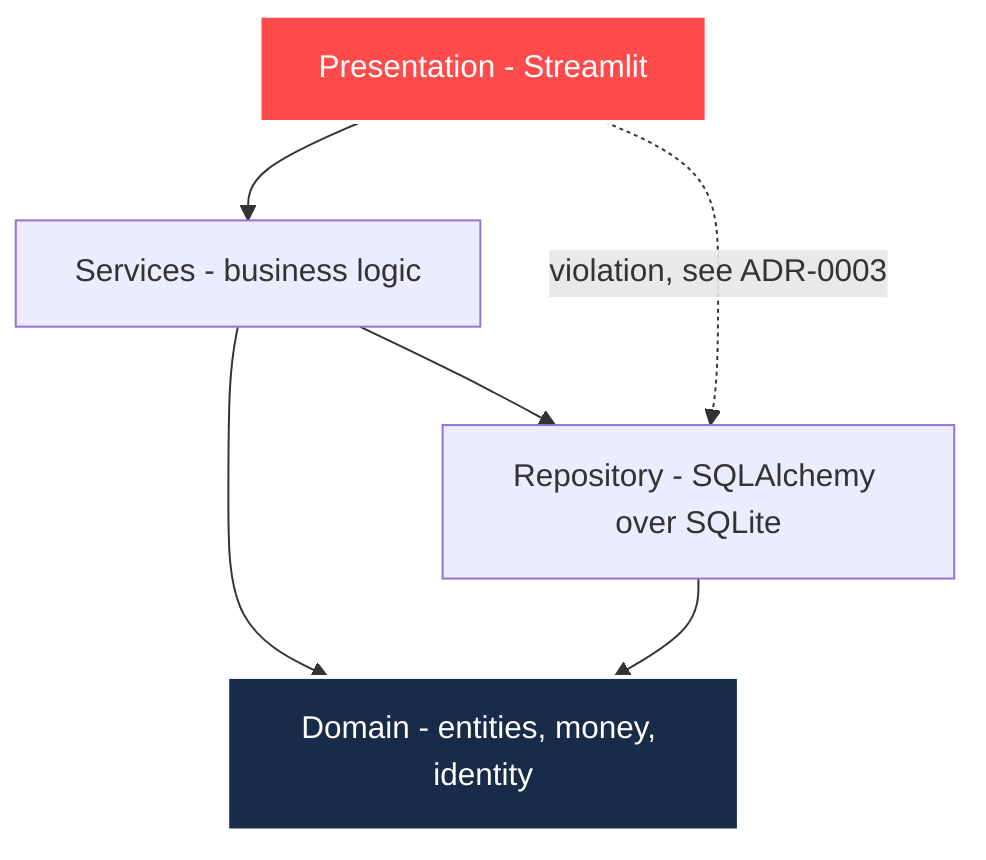

# Deterministic billing engine for driving schools

Python 3.12 · Clean Architecture · Pydantic v2 · SQLAlchemy 2.0 · Streamlit

A billing engine where the arithmetic is verifiable: amounts are `Decimal`, rounding is
explicit, identity documents are checksum-verified, and the stated invoice total equals
the sum of its parts with no tolerance.

The driving school is the setting. The engine is the subject.

---

## What this demonstrates

**Money is never a float.** Every amount is a `Decimal`, quantised to two places with
half-up rounding through a single module. Python's built-in `round` breaks ties toward
the even digit; invoicing breaks them away from zero. On a taxable base of 350.50 the tax
is exactly 73.605, where the two conventions disagree by a cent. The engine returns 73.61.

**Totals reconcile exactly.** The invoice model rejects itself if the parts do not add up
to the stated total. There is no tolerance, because a tolerance on a financial invariant
is a declaration that the arithmetic is untrusted.

**Identity is verified, not pattern-matched.** Spanish `DNI` and `NIE` carry a control
letter derived from the number modulo 23. The validator computes it, so `12345678A` is
rejected while `12345678Z` is accepted. A shape check would accept both.

**Requirements map to tests.** Every requirement carries an identifier, and
[`docs/50-traceability.md`](docs/50-traceability.md) states which test proves it and
which are still uncovered. Nine of fourteen today. The gaps are listed, not hidden.

## Documentation

The full lifecycle lives in [`docs/`](docs/README.md): charter, requirements, open
questions, architecture, data model, decision records, tasks, traceability and runbook.

Notably, [ADR-0003](docs/30-decisions/ADR-0003-service-layer-boundary.md) records a
boundary violation that is still present: the presentation layer reaches the repository
directly. It is written down with its consequences and its fix, rather than omitted.

## Architecture

Dependencies point inward. The domain depends on nothing.



| Module | Responsibility |
| :--- | :--- |
| `src/domain/` | Entities and invariants. `money.py` defines the rounding policy, `identity.py` the checksum |
| `src/services/` | Billing engine and in-memory PDF generation |
| `src/repository/` | SQLAlchemy persistence over SQLite |
| `src/ui/` | Streamlit dashboard |
| `tests/` | 43 tests |

## Running it

```powershell
python -m venv .venv
.\.venv\Scripts\activate
pip install -r requirements.txt
pytest -v
streamlit run src/ui/app.py
```

The dashboard opens on `http://localhost:8501` and seeds fictional demonstration data on
an empty database. No real personal data is used anywhere, including seeds.

## What this is not

A portfolio piece, not a product.

- The generated PDF is a commercial mock-up. It has no sequential invoice series, no
  issuer tax details and no retention policy, so it is not a legally valid invoice.
- The 21 percent `IVA` rate is applied uniformly. Driving school tuition may qualify for
  a different rate; this is unconfirmed and recorded as a known limitation.
- There is no authentication, no multi-tenant isolation and no schema migration path.
  Each is a deliberate exclusion, recorded in the charter, and each would block real use.

These are stated because a reviewer will find them anyway, and finding them undocumented
says more than the limitations themselves.

## Author

Architecture and implementation by [naindev](https://www.naindev.com/).
