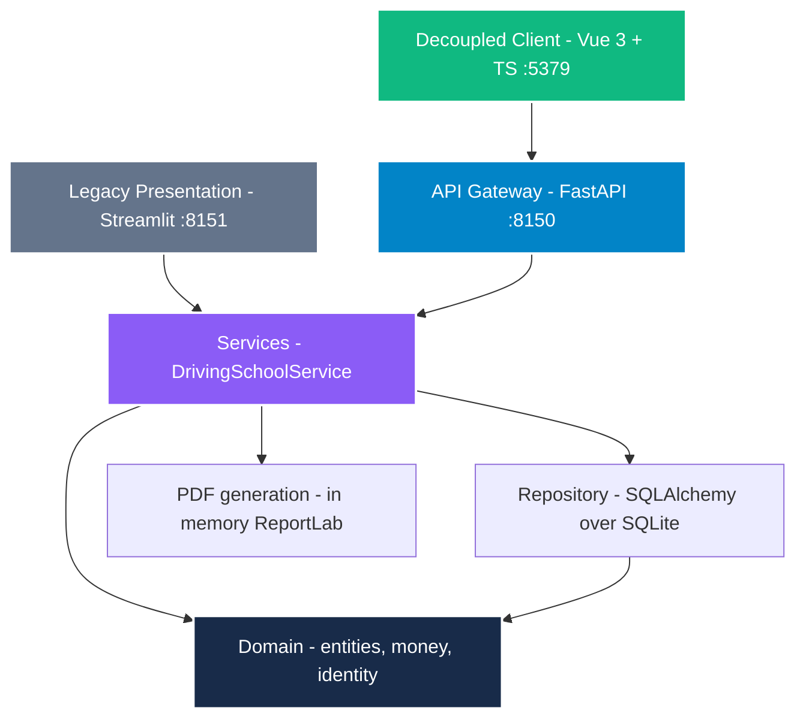

# Architecture

Status: Approved
Phase: Design

## Layers

Dependencies point inward. The domain depends on nothing.

## Layer contracts

| Layer | Path | May depend on | Must never |
| :--- | :--- | :--- | :--- |
| Client | `NainDrive.Client/` | FastAPI REST Gateway (`/api/v1`) | Direct database access |
| API Gateway | `src/api/` | Services, Domain | Import repository directly |
| Legacy UI | `src/ui/` | Services | Import the repository, calculate figures, enforce domain rules |
| Services | `src/services/` | Domain, Repository | Import presentation concerns (FastAPI or Streamlit) |
| Domain | `src/domain/` | Nothing | Import any other layer |
| Repository | `src/repository/` | Domain | Contain business rules |

## Boundary Debt Resolution (ADR-0003 & ADR-0006)

The architectural debt identified in ADR-0003 (`UI --> REPO` direct access) has been completely resolved:
- `DrivingSchoolService` was introduced in `src/services/driving_school_service.py`.
- All repository calls were removed from `src/ui/app.py` and `src/ui/components.py`.
- `src/ui/components.py` was refactored from 383 lines down to 195 lines, acting as a pure renderer.
- `src/api/main.py` provides a REST API gateway on port `8150`, documented with Scalar at `/docs`.
- `NainDrive.Client` provides a decoupled, accessible Vue 3 + TypeScript client on port `5379`.

## Deliberate simplicity

Single process, single SQLite file, no cloud bill. This respects the zero-cost constraint of the charter while providing full decoupling and headless API readiness.
