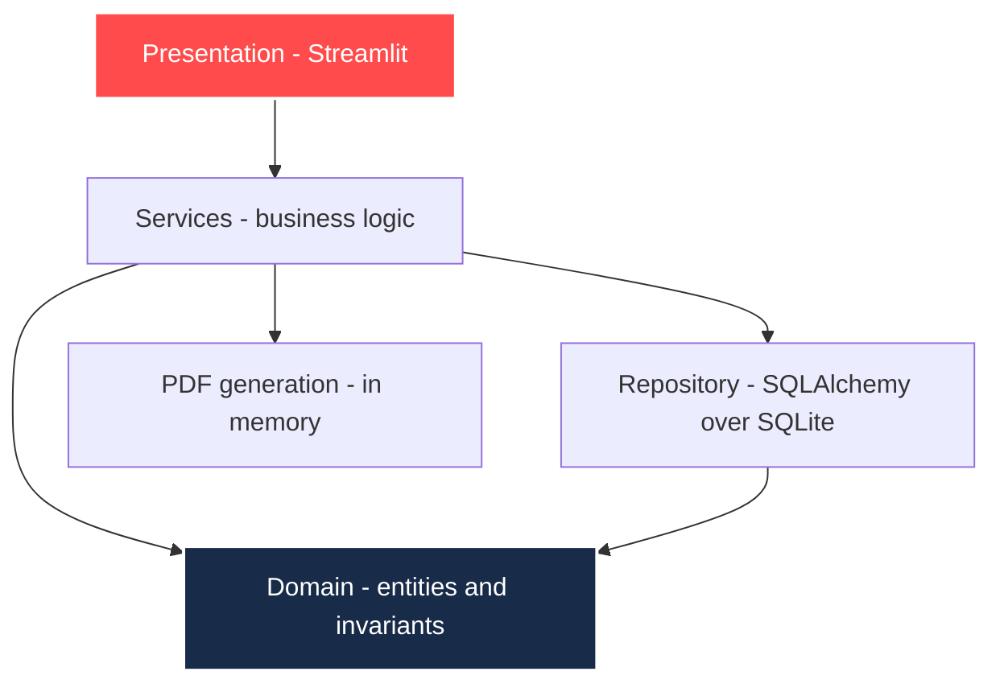

# Architecture

Status: Approved
Phase: Design

## Layers

Dependencies point inward. The domain depends on nothing.

## Layer contracts

| Layer | Path | May depend on | Must never |
| :--- | :--- | :--- | :--- |
| Presentation | `src/ui/` | Services | Import the repository, calculate figures, enforce domain rules |
| Services | `src/services/` | Domain, Repository | Import Streamlit or any presentation concern |
| Domain | `src/domain/` | Nothing | Import any other layer |
| Repository | `src/repository/` | Domain | Contain business rules |

## Known deviation

The presentation layer currently imports `SQLiteRepository` directly in both `src/ui/app.py` and `src/ui/components.py`, and passes the repository instance into rendering functions. This breaks the boundary above.

`src/ui/components.py` is 383 lines, the largest module in the codebase, and mixes styling, data access and figure preparation.

Tracked as ADR-0003 and task T-001. Until it is resolved, the diagram above describes the target, not the current state.

## Deliberate simplicity

Single process, single SQLite file, no network dependency. This is a constraint of the charter, not an oversight. Any proposal to introduce a database server, a queue or a separate API service needs an approved ADR that justifies it against the zero-cost constraint.
